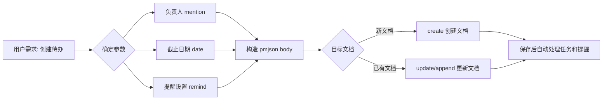

# 场景：创建待办任务列表（TaskList）

**快捷命令：**
```bash
# 创建包含待办任务的文档（从文件读取 body JSON）
iwiki-cli create --parent 67890 --title "任务列表" --type DOC --file ./content.json

# 在现有文档末尾追加待办任务
iwiki-cli append 123456 --after-file ./tasklist.json
```

## 工作流程



## PMJSON Body 格式说明

iWiki 使用 ProseMirror JSON（pmjson）格式存储富文本文档内容。待办任务列表对应的节点层级关系为：

```
doc
 └── taskList（任务列表容器）
      └── taskItem（单个任务项）
           ├── mention（负责人 @提及）
           ├── text（任务描述文本）
           └── date（截止日期 + 提醒设置）
```

### 核心节点类型

| 节点类型 | 说明 | 必填属性 |
|---------|------|---------|
| `taskList` | 任务列表容器 | `localId` |
| `taskItem` | 单个任务项 | `localId`, `state`, `update_time` |
| `mention` | @提及（指定负责人） | `id`, `text` |
| `date` | 截止日期 | `timestamp`, `localId` |

### 属性详解

#### taskList.attrs
| 属性 | 类型 | 说明 |
|------|------|------|
| `localId` | string | UUID，任务列表唯一标识 |

#### taskItem.attrs
| 属性 | 类型 | 说明 |
|------|------|------|
| `localId` | string | UUID，任务项唯一标识 |
| `state` | string | 任务状态：`"TODO"` 或 `"DONE"` |
| `update_time` | string | 最后更新时间，格式 `"YYYY-MM-DD HH:mm:ss"` |

#### mention.attrs（负责人）
| 属性 | 类型 | 说明 |
|------|------|------|
| `id` | string | **用户名**（英文 ID，如 `"jaxxonli"`） |
| `mentionid` | string | 提及的唯一标识（可选，如 `"s59mmm6c6"`） |
| `text` | string | 显示文本，格式 `"@username(中文名)"` |
| `accessLevel` | string | 访问级别（通常为空字符串 `""`） |
| `userType` | null | 用户类型（通常为 `null`） |

#### date.attrs（截止日期 + 提醒）
| 属性 | 类型 | 说明 |
|------|------|------|
| `timestamp` | string | **毫秒时间戳**（注意：已加 8 小时偏移，即 UTC+8 的 00:00:00 对应的毫秒数） |
| `localId` | string | UUID，日期节点唯一标识 |
| `remind` | object | 提醒设置（见下表） |

#### remind 对象（提醒设置）
| 属性 | 类型 | 说明 | 可选值 |
|------|------|------|--------|
| `remind` | boolean | 是否开启提醒 | `true` / `false` |
| `remind_time` | string | 提醒时刻（当天几点提醒） | 如 `"09:00"`, `"10:00"`, `"14:00"` |
| `remind_option` | string | 提醒时机 | `"0"` = 当天, `"1"` = 提前一天, `"2"` = 提前两天, `"3"` = 提前一周 |
| `repeat` | string | 重复方式 | `"0"` = 不重复, `"1"` = 每天, `"2"` = 每周, `"3"` = 每月 |
| `end_repeat` | string | 结束重复时间（时间戳或空字符串） | `""` 表示无结束时间 |
| `remind_user` | string[] | 需要提醒的用户列表 | 如 `["provihuang", "jaxxonli"]` |

## 时间戳计算规则

iWiki 日期的 `timestamp` 使用 **毫秒级时间戳**，且编辑器内已加 8 小时偏移。计算方式：

```
timestamp = (目标日期 UTC+8 零点的 Unix 时间戳) × 1000
```

**示例：**
- 目标截止日期：`2026-06-03`
- UTC+8 零点 = UTC `2026-06-02 16:00:00` = Unix `1780444800`
- timestamp = `"1780444800000"`

> ⚠️ 后端存储时会自动减去 8 小时进行还原，因此生成时必须使用带偏移的值。

## 完整 PMJSON 示例

### 示例 1：创建单个待办任务（含负责人 + 截止日期 + 提醒）

**用户需求：** "创建一个待办，负责人是 jaxxonli，截止日期 2026-06-03，提前一天上午 10 点提醒 provihuang 和 jaxxonli，每周重复"

```json
{
  "type": "doc",
  "content": [
    {
      "type": "taskList",
      "attrs": {
        "localId": "b8c46506-2c55-4455-9fe7-f720f39240f2"
      },
      "content": [
        {
          "type": "taskItem",
          "attrs": {
            "localId": "3132ad05-5c97-451c-bd86-2e94615f5de0",
            "state": "TODO",
            "update_time": "2026-06-03 11:37:44"
          },
          "content": [
            {
              "type": "text",
              "text": "完成 skill 文档编写 "
            },
            {
              "type": "mention",
              "attrs": {
                "id": "jaxxonli",
                "mentionid": "s59mmm6c6",
                "text": "@jaxxonli(李晋)",
                "accessLevel": "",
                "userType": null
              }
            },
            {
              "type": "text",
              "text": " "
            },
            {
              "type": "date",
              "attrs": {
                "timestamp": "1780444800000",
                "localId": "0f0b1d03-ba23-4b95-81f2-b45398219740",
                "remind": {
                  "remind": true,
                  "remind_time": "10:00",
                  "remind_option": "1",
                  "repeat": "2",
                  "end_repeat": "",
                  "remind_user": ["provihuang", "jaxxonli"]
                }
              }
            }
          ]
        }
      ]
    },
    {
      "type": "paragraph"
    }
  ],
  "version": 1
}
```

### 示例 2：创建多个待办任务（不同负责人和日期）

**用户需求：** "创建任务列表：1) jaxxonli 完成代码评审，6月5日截止；2) provihuang 更新文档，6月10日截止"

```json
{
  "type": "doc",
  "content": [
    {
      "type": "taskList",
      "attrs": {
        "localId": "a1b2c3d4-5678-90ab-cdef-111111111111"
      },
      "content": [
        {
          "type": "taskItem",
          "attrs": {
            "localId": "task-001-uuid-generated",
            "state": "TODO",
            "update_time": "2026-06-03 12:00:00"
          },
          "content": [
            {
              "type": "mention",
              "attrs": {
                "id": "jaxxonli",
                "text": "@jaxxonli(李晋)",
                "accessLevel": "",
                "userType": null
              }
            },
            {
              "type": "text",
              "text": " 完成代码评审 "
            },
            {
              "type": "date",
              "attrs": {
                "timestamp": "1780617600000",
                "localId": "date-001-uuid-generated",
                "remind": {
                  "remind": true,
                  "remind_time": "09:00",
                  "remind_option": "1",
                  "repeat": "0",
                  "end_repeat": "",
                  "remind_user": ["jaxxonli"]
                }
              }
            }
          ]
        },
        {
          "type": "taskItem",
          "attrs": {
            "localId": "task-002-uuid-generated",
            "state": "TODO",
            "update_time": "2026-06-03 12:00:00"
          },
          "content": [
            {
              "type": "mention",
              "attrs": {
                "id": "provihuang",
                "text": "@provihuang(黄天意)",
                "accessLevel": "",
                "userType": null
              }
            },
            {
              "type": "text",
              "text": " 更新文档 "
            },
            {
              "type": "date",
              "attrs": {
                "timestamp": "1781049600000",
                "localId": "date-002-uuid-generated",
                "remind": {
                  "remind": true,
                  "remind_time": "09:00",
                  "remind_option": "0",
                  "repeat": "0",
                  "end_repeat": "",
                  "remind_user": ["provihuang"]
                }
              }
            }
          ]
        }
      ]
    },
    {
      "type": "paragraph"
    }
  ],
  "version": 1
}
```

### 示例 3：仅指定负责人，无截止日期和提醒

```json
{
  "type": "doc",
  "content": [
    {
      "type": "taskList",
      "attrs": {
        "localId": "simple-tasklist-uuid"
      },
      "content": [
        {
          "type": "taskItem",
          "attrs": {
            "localId": "simple-task-uuid",
            "state": "TODO",
            "update_time": "2026-06-03 12:00:00"
          },
          "content": [
            {
              "type": "mention",
              "attrs": {
                "id": "jaxxonli",
                "text": "@jaxxonli(李晋)",
                "accessLevel": "",
                "userType": null
              }
            },
            {
              "type": "text",
              "text": " 跟进项目进度"
            }
          ]
        }
      ]
    },
    {
      "type": "paragraph"
    }
  ],
  "version": 1
}
```

## 实践示例

### 示例 1：在新文档中创建带负责人和提醒的待办

**用户需求：** "在我的空间下创建一个待办文档，给 jaxxonli 安排一个任务'完成接口联调'，6月5日截止，提前一天10点提醒"

**执行步骤：**

1. **确定用户空间**
```bash
iwiki-cli recent edit --page_size 3
```

2. **生成 UUID 并计算时间戳**
   - `localId` 使用标准 UUID v4 格式
   - 6月5日截止 → timestamp = `"1780617600000"`（2026-06-05 UTC+8 00:00:00）
   - `update_time` 使用当前时间

3. **构造 pmjson 文件** (保存为 `/tmp/tasklist_body.json`)
```json
{
  "type": "doc",
  "content": [
    {
      "type": "taskList",
      "attrs": {
        "localId": "<生成的UUID>"
      },
      "content": [
        {
          "type": "taskItem",
          "attrs": {
            "localId": "<生成的UUID>",
            "state": "TODO",
            "update_time": "2026-06-03 11:55:00"
          },
          "content": [
            {
              "type": "mention",
              "attrs": {
                "id": "jaxxonli",
                "text": "@jaxxonli(李晋)",
                "accessLevel": "",
                "userType": null
              }
            },
            {
              "type": "text",
              "text": " 完成接口联调 "
            },
            {
              "type": "date",
              "attrs": {
                "timestamp": "1780617600000",
                "localId": "<生成的UUID>",
                "remind": {
                  "remind": true,
                  "remind_time": "10:00",
                  "remind_option": "1",
                  "repeat": "0",
                  "end_repeat": "",
                  "remind_user": ["jaxxonli"]
                }
              }
            }
          ]
        }
      ]
    },
    {
      "type": "paragraph"
    }
  ],
  "version": 1
}
```

4. **创建文档**
```bash
iwiki-cli create --parent <parent_id> --title "本周待办任务" --type DOC --file /tmp/tasklist_body.json
```

5. **清理临时文件**
```bash
rm /tmp/tasklist_body.json
```

### 示例 2：在现有文档中追加待办任务

**用户需求：** "在文档 12345 追加一个任务，@provihuang 完成数据迁移，6月10日截止，当天 9 点提醒"

**执行步骤：**

1. **获取现有文档内容**
```bash
iwiki-cli get 12345 --format json
```

2. **在 body 中找到已有 taskList 或创建新的 taskList，追加 taskItem**

3. **更新文档**
```bash
iwiki-cli update 12345 --file /tmp/updated_body.json
```

4. **清理临时文件**
```bash
rm /tmp/updated_body.json
```

## 注意事项

1. **UUID 生成**：所有 `localId` 必须使用标准 UUID v4 格式（如 `"b8c46506-2c55-4455-9fe7-f720f39240f2"`），可通过 `uuidgen` 或编程生成
2. **时间戳偏移**：`date.attrs.timestamp` 必须使用 UTC+8 零点的毫秒时间戳，后端保存时会自动减去 8 小时
3. **update_time 格式**：`taskItem.attrs.update_time` 使用 `"YYYY-MM-DD HH:mm:ss"` 格式
4. **文档类型**：包含 taskList 的文档必须是 `DOC` 类型（富文本），不是 `MD` 类型
5. **mention 位置**：`mention` 节点通常放在 `taskItem.content` 的开头或紧跟在任务描述文本之后
6. **提醒生效条件**：`remind.remind` 必须设为 `true` 才能生效，同时需要指定 `remind_user`
7. **保存后自动处理**：文档保存后，后端会自动：
   - 提取所有 `taskItem` 并存入 `iwiki_inline_task` 表
   - 提取 `mention` 用户存入 `iwiki_inline_task_staff_relation` 表
   - 提取 `date` + `remind` 存入 `iwiki_date_remind` 表
8. **remind_option 枚举值**：
   - `"0"` = 当天提醒
   - `"1"` = 提前 1 天提醒
   - `"2"` = 提前 2 天提醒
   - `"3"` = 提前 1 周提醒
9. **repeat 枚举值**：
   - `"0"` = 不重复
   - `"1"` = 每天重复
   - `"2"` = 每周重复
   - `"3"` = 每月重复
10. **结尾段落**：body 的 `content` 数组末尾通常需要加一个 `{"type": "paragraph"}` 空段落节点
