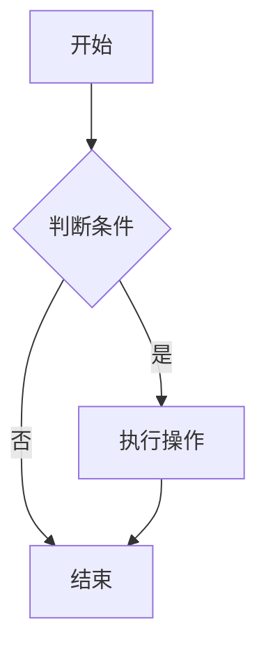

# cmd-flowchart — 流程图

使用 `tdocs-cli flowchart ...` 创建腾讯文档流程图——流程架构展示与可视化。

## 能力分类

| 分类 | 包含的能力 | CLI 命令 |
|---|---|---|
| 创建 | 通过 Mermaid 创建流程图 | `flowchart create-by-mermaid` |

## 参数说明

### flowchart create-by-mermaid

| 参数 | 必填 | 说明 |
|---|---|---|
| `--title` | 否 | 流程图标题 |
| `--mermaid` | 否 | Mermaid 格式内容 |
| `--parent-id` | 否 | 父节点 ID（指定存放位置） |

## Mermaid 格式说明

使用标准 [Mermaid](https://mermaid.js.org/) 语法定义流程图：



支持的图表类型包括：`graph`（流程图）、`sequenceDiagram`（时序图）、`classDiagram`（类图）等。

## 代表性示例

```bash
# 创建简单流程图
tdocs-cli flowchart create-by-mermaid --title "部署流程" --mermaid @./flowchart.mmd

# 内联 Mermaid 内容创建
tdocs-cli flowchart create-by-mermaid --title "审批流程" \
    --mermaid "graph TD; A[提交] --> B[审核]; B --> C[通过]"

# 在指定空间节点下创建
tdocs-cli flowchart create-by-mermaid --title "系统架构" --mermaid @./arch.mmd --parent-id <parent-id>
```

**提示**：`--mermaid` 支持 `@filepath` 语法从文件读取内容。

## 权威来源

```
tdocs-cli flowchart --help
tdocs-cli flowchart create-by-mermaid --help
```
